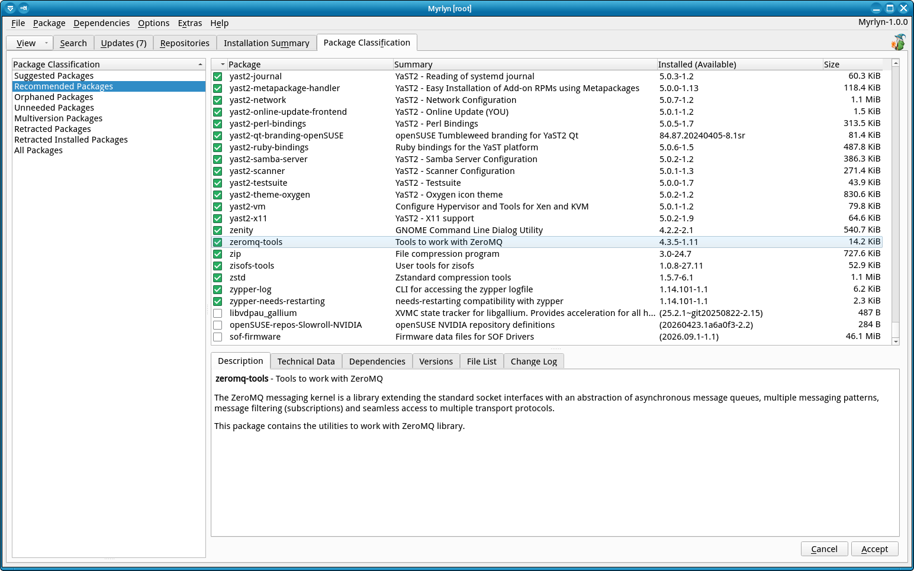

# Package Classification View

_Author: Stefan Hundhammer (GitHub: @shundhammer)_

_Up: [↗ Help Center](help-center.md)_

 

-------------------------

This is about Myrlyn's "Package Classification" view. If you don't see it, use
the "View" button at the left of the open tabs, then "Package Classification".

## Orphaned Packages

An _orphaned_ package is a package that is not available in any of the active
repos. Its version number is displayed in red in the "Version" column in the
package list, and there is no other version in the "Versions" view below the
package list.

This is not a critical situation, but you might consider what happens if this
package has a security or other severe bug; you will not get any update,
because you don't have a repo that would get such an update.

This situation can happen if

- you remove or deactivate a repo

- you install a package manually from a local or manually downloaded RPM file
  with an `rpm` or `zypper in ./xy.rpm`` command line.

See also [issue #71](https://github.com/shundhammer/myrlyn/issues/71).

This situation is easy to avoid if you add a local directory as a repo with a
`dir:` URL like `dir:/work/rpms` and install such packages from there: Then
there is a repo with that RPM, so those RPMs will not be displayed as
_orphaned_.

You will still not get any updates, of course; unless you build those RPMs
yourself from up-to-date sources like a GitHub source repository.

## Unneeded Packages

An _unneeded_ package is a package that was previously installed because of
dependencies, but now it's no longer needed; typically because the package that
required it was removed.

You can safely remove those packages. Remember there is "All in this List" ->
"Delete" in the "Package" menu or in the package list's context menu (right
mouse click).

If any of those packages is needed again in the future, it will simply be
installed again.

## Retracted Packages

A retracted package is a package version that was released as a maintenance
update, but then it turned out after the package was released that there are
severe problems with that version, so that specific version was marked as
_retracted_ on the update servers, and libzypp (both in `zypper` and Myrlyn)
will not use that version as an update anymore.

But some users may already have installed it, so they should _downgrade_ this
package to the latest non-retracted version.

In the package list, a retracted version is displayed in red (very much like an
_orphaned_ version), and it shows a message **"[RETRACTED]"** in the "Versions"
view below the package list.

If you start Myrlyn, and it immediately switches to the "Package
Classification" view and within that view to "Retracted Installed Packages",
that means that you have retracted packages installed.

In that case, downgrading to the last non-retracted version is strongly
recommended: Switch to the "Versions" view below the package list and select
the highest version (from the same architecture) that is _not_ retracted. The
package status automatically changes to "update" which in this case is really a
downgrade.

The normal case is that "Retracted Installed Packages" is empty.

More information in the
[original pull request](https://github.com/libyui/libyui-qt-pkg/pull/82).

-------------------------

_Next: [↗ Installation Summary](inst-summary.md)_
  &nbsp;&nbsp;&nbsp;&nbsp;&nbsp;&nbsp;
_Previous: [↗ Managing Repositories](repos-management.md)_
