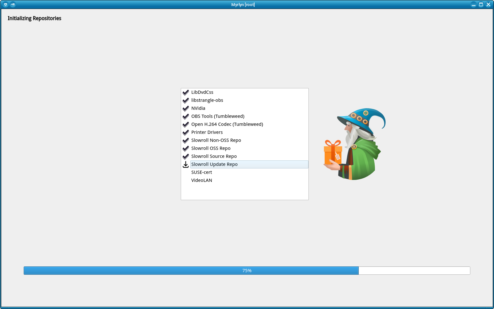
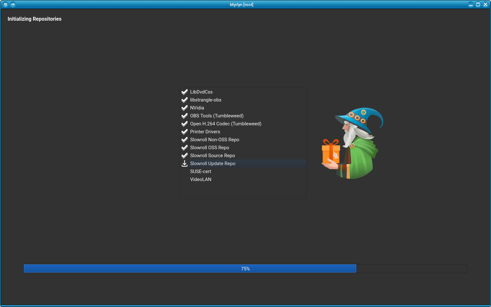

# Myrlyn Help: Customization

_Author: Stefan Hundhammer (GitHub: @shundhammer)_

_Up: [↗ Help Center](help-center.md)_

 &nbsp;&nbsp;&nbsp; 

-------------------------


## Changing Desktop Settings for the Root User

### Why do I Need That?

In most cases, you will need to run Myrlyn as _root_ (with `sudo` / `myrlyn-sudo`
or with `kdesu` / `gnomesu`). But that will use the desktop settings of the
_root_ user, not the ones that you customized for your normal user account.

If you didn't do much customizing in your desktop environment (KDE Plasma,
GNOME, Xfce, ...), that may not be necessary. But if you did because some
defaults like the font size are much too small or much too large, or if you
prefer a dark theme, you may want to do that for the _root_ user as well.


### No Root Password Set?

In recent openSUSE releases (from Leap 16.0 on), the default is not to set a
_root_ password: If you create a first user account during the system
installation, that user account is implicitly added to the _wheel_ user group
and is granted _root_ privileges for `sudo`. In that case, you are no longer
required to set a _root_ password.

Notice that in all cases a _root_ user account (UID 0) still exists; it might
just not have a password, so you may not be able to log in as _root_.

But you can always add a _root_ password later:

```console
sh@meteor:~> sudo passwd root
(enter the sudo password)
New password:
Retype new password:
```

Notice that the default sudo password for Leap 16.0 is **your normal user's password**.

If you wish to delete the _root_ password again:

```console
sh@meteor:~> sudo passwd -d root
```


### Logging into the Root User's Desktop

The simplest way to set desktop settings for the _root_ user is to log in as
_root_ from the graphical login manager. Make sure to select the same session
type (KDE Plasma / GNOME / Xfce / ...) that you also use as a normal user.

If no _root_ password was set during installation, see the previous section "No
_root_ password set?" how to set one, and after you log out of the _root_
user's desktop session again, to delete it again (if you wish; you don't need
to).

Log into the desktop as _root_ and set the fonts, widget theme, icon theme etc.
Also look for settings like "[ ] Apply to non-GNOME applications". This may
vary between different desktop environments.


### Using qt6ct

If you can't or don't wish to log into a desktop session as _root_, you can use
Qt's `qt6ct` utility to change some GUI settings.

Make sure that package `qt6ct` is installed:

```console
sh@meteor:~> sudo zypper in qt6ct
```

Call `qt6ct` for your normal user account, change the settings to your liking,
save the result, and then do the same for the _root_ user.

With `qt6ct`, you can set the widget style, the color scheme ("darker" and
"dusk" are dark themes) the fonts, and some other things. Don't forget to hit
the "OK" or "Apply" button to save the settings.

For your normal user account:

```console
sh@meteor:~> qt6ct
```

For the _root_ user:

```console
sh@meteor:~> sudo -E qt6ct
```

You may have to temporarily grant the _root_ user access to your normal user's
X11 or Wayland display.


#### Setting QT_QPA_PLATFORMTHEME

If you use `qt6ct` to configure fonts, the widget theme, or the icon theme, you
also need to set the `QT_QPA_PLATFORMTHEME` environment variable to `qt6ct`:

```console
sh@meteor:~> export QT_QPA_PLATFORMTHEME=qt6ct
```

You can add that to your shell startup files like `~/.bashrc` for use with
Myrlyn without _root_ privileges. But for use _with_ _root_ privileges, you
need to add it to the environment of the _root_ user.

You can either edit `/root/.bashrc` or, better yet, add it to your normal
user's `~/.config/openSUSE/myrlyn-sudo.conf` file (for use with `myrlyn-sudo`,
not with `kdesu` or `sudo -E`) - see next section.


#### Using myrlyn-sudo.conf

You can override any of the environment variables in the `env_keep` block in
[`myrlyn-sudo`](https://github.com/shundhammer/myrlyn/blob/huha-help/src/myrlyn-sudo)
in your (normal user's!) `~/.config/openSUSE/myrlyn-sudo.conf` file, including

- `QT_QPA_PLATFORMTHEME` (typically `qt6ct`)
- `QT_ENABLE_HIGHDPI_SCALING` (`0` or `1`)
- `QT_SCALE_FACTOR` (`1.0`, `1.25`, `1.5`, ...)

Just use a text editor (`vi`, `emacs`, `nano`, or the one from your KDE / GNOME
/ Xfce desktop environment) to create it as a new file and add the variables in
bash syntax.

No execute permissions are needed: `myrlyn-sudo` will will read the file with
the bash `source` command.

Example:

```console
sh@meteor:~> whoami
sh
sh@meteor:~> cd ~/.config/openSUSE/
sh@meteor:~/.config/openSUSE> vi myrlyn-sudo.conf
(edit the file)
sh@meteor:~/.config/openSUSE> cat myrlyn-sudo.conf
QT_QPA_PLATFORMTHEME=qt6ct

# Avoid hiDPI scaling on my 160 dpi laptop
QT_ENABLE_HIGHDPI_SCALING=0
QT_SCALE_FACTOR=1
```


### Checking the Log

Relevant environment variables and some other settings are written to the first
few lines of Myrlyn's log file:

```console
sh@meteor:~> sudo head -n 22 /tmp/myrlyn-root/myrlyn.log

2026-11-03 13:58:56.258 [378349] <Info>    Logger.cc:124 openLogFile():  -- Log Start --

...  main.cc:172 logVersion():  myrlyn-1.1.0 built with Qt 6.11.2
...  MyrlynApp.cc:66 MyrlynApp():  Creating MyrlynApp
...  MyrlynApp.cc:77 MyrlynApp():  _optFlags: 0x0
...  MyrlynApp.cc:134 logQtEnv():  QT_ENABLE_HIGHDPI_SCALING=0
...  MyrlynApp.cc:134 logQtEnv():  QT_QPA_PLATFORMTHEME=qt6ct
...  MyrlynApp.cc:134 logQtEnv():  QT_SCALE_FACTOR=1
...  MyrlynApp.cc:134 logQtEnv():  XDG_CURRENT_DESKTOP=XFCE
...  MyrlynApp.cc:134 logQtEnv():  XFCE_THEME=Adwaita
...  MyrlynApp.cc:138 logQtEnv():  ----------
...  MyrlynApp.cc:595 detectDarkWidgetTheme():  Fallback detection method
...  MyrlynApp.cc:601 detectDarkWidgetTheme():  Using a light widget theme
...  MyrlynApp.cc:169 createMainWin():  Creating the main window
...  MainWindow.cc:41 MainWindow():  Device pixel ratio: 1
...  MainWindow.cc:42 MainWindow():  Logical  dpi: 128
...  MainWindow.cc:43 MainWindow():  Physical dpi: 161.806
...  MainWindow.cc:44 MainWindow():  Default font: Droid Sans,10,-1,5,400,0,0,0,0,0,0,0,0,0,0,1,Regular,0,0
...  MainWindow.cc:45 MainWindow():  Heading font: Droid Sans,11,-1,5,700,0,0,0,0,0,0,0,0,0,0,1,Regular,0,0
...  MainWindow.cc:46 MainWindow():  QStyle: qt6ct-style
...  MyrlynApp.cc:85 MyrlynApp():  Creating MyrlynApp done
```

Notice that there are different log files for different users:

- _root_ user: `/tmp/myrlyn-root/myrlyn.log` (and `zypp.log`)
- Normal user: `/tmp/myrlyn-$USER/myrlyn.log` (and `zypp.log`)


# Customization FAQs

- [↗ Font size](font-size.md)

- [↗ GUI scaling](gui-scaling.md)

- [↗ Dark theme](dark-theme.md)


-------------------------

_Next: [↗ Updates](updates.md)_
  &nbsp;&nbsp;&nbsp;&nbsp;&nbsp;&nbsp;
_Previous: [↗ Permissions and Privileges](permissions.md)_
