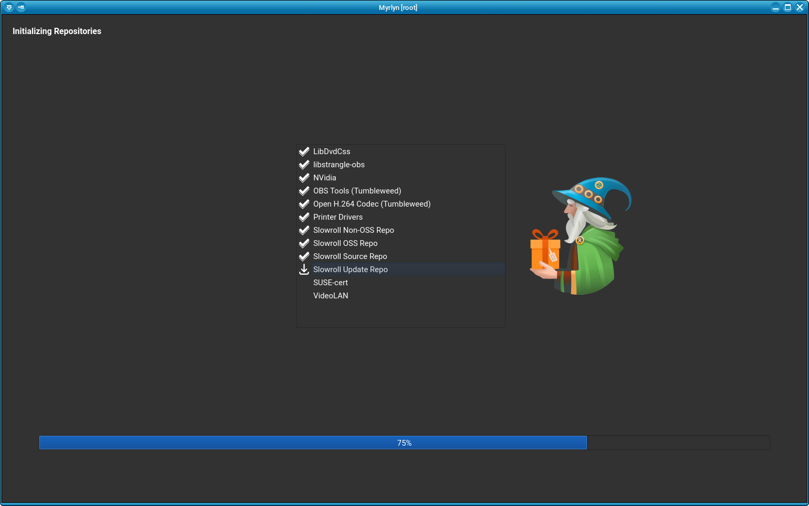
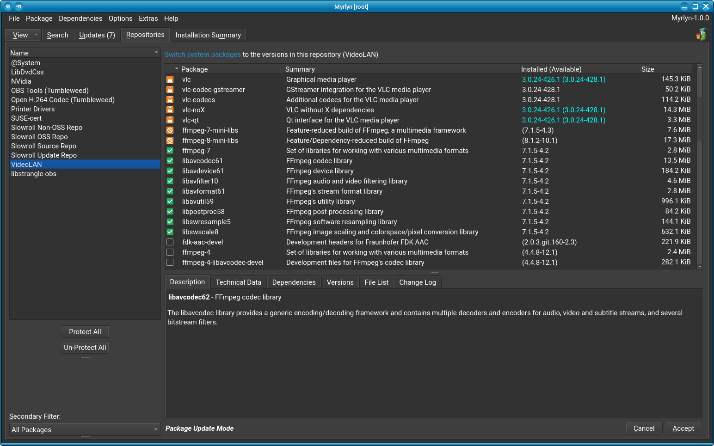

# Dark Theme for Myrlyn

_Author: Stefan Hundhammer (GitHub: @shundhammer)_

_Up: [↗ Customization](customization.md)_

 &nbsp;&nbsp;&nbsp; 

-------------------------


Myrlyn as a non-privileged user should use your desktop environment's widget
theme out of the box.

But the normal case is to start Myrlyn with _root_ privileges, and that means
that you have to set the theme for the _root_ user account.

The easy and recommended way is to log in as as _root_ in the graphical login
manager with the same session type (KDE Plasma, GNOME, Xfce, ...) that you use
as a normal (non-privileged) user, set the widget theme, and then log out again.

If that does not work for any reason, try running `qt6ct` as _root_ :

```console
sh@meteor:~> sudo -E qt6ct
```

and set one of the dark color schemes ("darker" or "dusk").

Don't forget to set

```
export QT_QPA_PLATFORMTHEME=qt6ct
```

in your normal user's `~/.config/openSUSE/myrlyn-sudo.conf` (if you use
`myrlyn-sudo`) or in `/root/.bashrc`.

For more details about both methods, see [↗ Customization](customization.md).


## Debugging

Check the environment variables in the log:

```console
sh@meteor:~> sudo grep "QT_" /tmp/myrlyn-root/myrlyn.log
...  MyrlynApp.cc:134 logQtEnv():  QT_QPA_PLATFORMTHEME=qt6ct
```

`QT_QPA_PLATFORMTHEME` will override whatever you set in the _root_ user's
desktop environment. If that is not what you want, check `/root/.bashrc` and
other shell startup files where this might come from. If all else fails, and
you are using `myrlyn-sudo` (which is recommended anyway), unset it in
`myrlyn-sudo.conf`:

```console
sh@meteor:~> cat ~/.config/openSUSE/myrlyn-sudo.conf
unset QT_QPA_PLATFORMTHEME
```


## Support Packages


You may also need to install some additional packages for theme support for
applications that are not native to your desktop environment.

At the time of this writing (11/2026), that would be the following packages:

- KDE Plasma:
  - `plasma6-integration-plugin` (for Qt6 applications like Myrlyn)
  - `plasma6-integration-plugin-qt5` (for Qt5 applications)
  - `kf6-frameworkintegration-plugin`

- GNOME / Xfce / Mate:
  - `qt6-platformtheme-gtk3`
  - `adwaita-qt6` (for use in `qt6ct` for Qt6 applications like Myrlyn)
  - `adwaita-qt5`

This list may be incomplete. Please consult your preferred web search engine.


-------------------------

_Next: (None)_
  &nbsp;&nbsp;&nbsp;&nbsp;&nbsp;&nbsp;
_Previous: [↗ GUI scaling](gui-scaling.md)_
