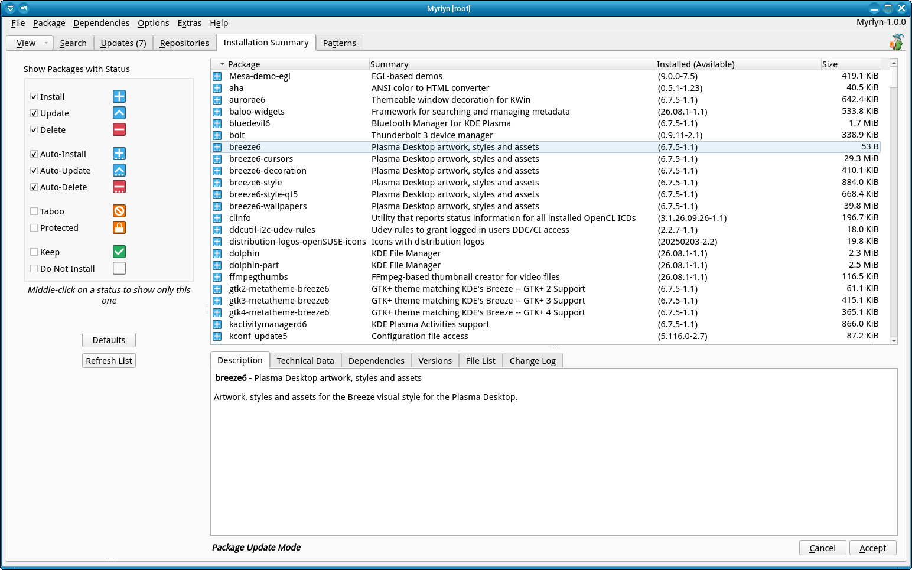

# Myrlyn Help: Installation Summary

_Author: Stefan Hundhammer (GitHub: @shundhammer)_

_Up: [↗ Help Center](help-center.md)_

 

-------------------------

This is about Myrlyn's "Installation Summary" view. If you don't see it, use
the "View" button at the left of the open tabs, then "Installation Summary".

This view is also available as a secondary filter named "Status" in the
"Repositories" view.

## The General Idea

This view is meant to be used as a summary of pending changes after you made
more than just very trivial changes in other views; for example:

- Marked packages for installation or deletion from the "Search" view or the
  "Repositories" view, for example

- Marked whole patterns for installation or deletion from the "Patterns" view

- Used "Package Update" or "Dist-Upgrade" from the "Updates" view.

All of these actions may automatically mark other packages for installation,
update or deletion because of dependencies. In that case, you will get a pop-up
dialog with very much the same view for those automatic changes if you don't
explicitly open this "Installation Summary" view before you hit the "Accept"
button.

But the "Installation Summary" shows you not only the automatic changes, but
_all_ changes that will be executed with "Accept".

By default, it will show all packages that will be newly installed, updated or
removed, no matter if by your explicit request, or automatically because of
dependencies. In addition to that, it will show you all packages in status
"Protected" (installed and locked against change) or "Taboo" (not installed and
locked against being installed).

If you have many packages in status "Protected" or "Taboo", consider
deselecting them in the status check boxes in the left panel.

## Managing Huge Updates

A large update with more than, say, 20 packages in the list, may be
overwhelming in this view; you might want to be more selective what changes to
display.

Of course an update has many packages in status "update"; that is expected. But
does it also cause new packages to be installed by dependencies? Or even
packages to be removed? Let's find out.

### Check for Auto-Installed Packages

Select only status "Auto-Install". You can uncheck all other status check boxes
in the left panel, or you can simply click "Auto-Install" with the middle mouse
button to check only this one and uncheck all others.

The remaining packages in the list are those that will be installed because of
dependencies; you didn't explicitly ask for them. It probably makes sense to
keep them.

Click "Install" to also see the packages that you did explicitly ask for.

Click "Defaults" to restore the default settings for the check boxes.

### Check for Auto-Deleted Packages

Similar to above, select only "Auto-Delete" or middle-click it.

The remaining packages were automatically marked for deletion because of
dependencies.

This typically happens when another package that you requested
has a "Conflicts" or an "Obsoletes" dependency on one of these packages.

Remember to use "Defaults" before you leave this view to avoid surprises the
next time you use it.

-------------------------

_Next: [↗ Package Classification View](classification.md)_
  &nbsp;&nbsp;&nbsp;&nbsp;&nbsp;&nbsp;
_Previous: [↗ Patterns](patterns.md)_
