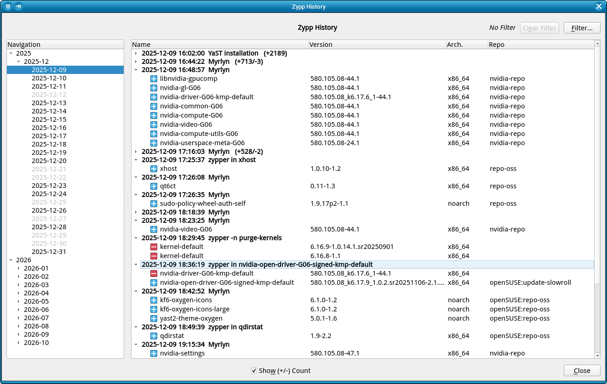

# Myrlyn Help: Miscellaneous

_Author: Stefan Hundhammer (GitHub: @shundhammer)_

_Up: [↗ Help Center](help-center.md)_

-------------------------


## Status Taboo and Protected

Package status "Taboo" and "Protected" correspond to what zypper calls "locks",
but with some additional semantics:

- Taboo: Not installed and locked. Never install this package because of
  dependencies.

- Protected: Installed and locked. Never delete this package because of
  dependencies, and never update it.

This terminology was introduced in the YaST2 package manager long before zypper
and libzypp existed. Unfortunately, libzypp / zypper introduced their own
conflicting terminology afterwards, which now adds confusion.

Still, in the context of Myrlyn, "Taboo" and "Protected" are a better fit,
because they imply a "not installed" / "installed" status along with the
"locked" status.

You can directly benefit from this in the "Protect All" / "Un-Protect All"
buttons in the "Repositories" view: There is no doubt that they only affect
packages that are already installed, while leaving packages with the "Taboo"
status untouched. Just because you want to un-protect (i.e., remove the lock
from) the other packages in that repo doesn't mean that you also want to remove
the lock from those taboo'ed packages. This makes the handling _much_ more
convenient.


## Zypp History

 

Menu "Extras" -> "Show History"

This shows the content of `/var/log/zypp/history` in a much better readable form.

Unfortunately, this file's parent directory has very restrictive permissions,
so this is only available when you are running Myrlyn with _root_ privileges.

But you can copy it with `sudo` and then use it from Myrlyn without _root_
privileges:

```console
sh@meteor:~> sudo cp /var/log/zypp/history ~/tmp/my-zypp-history
sh@meteor:~> myrlyn --zypp-history ~/tmp/my-zypp-history
```

You can navigate along the timeline on the left to one specific day, or view a
whole month's changes.

Each session from any of the available libzypp-based package management tools
(zypper, Myrlyn, or packagekitd, which includes Cockpit, KDE Discover and GNOME
Software) is displayed separately with a timestamp. You can collapse or expand
individual sessions.

You can also filter by package name, repository names, repository changes and
more criteria. This makes it easy to follow individual packages or groups of
packages over several months as they were added, updated, or removed, or all
packages that were added, updated or removed from one specific repository.

For use in bug reports or user forums, you can share screenshots. Collapse and
expand sessions as needed, and resize the window to fit all important content.
Most desktop environments support creating a screenshot with the "Print Screen"
key.


### Further Reading

- [GitHub Issue 94: Zypp History](https://github.com/shundhammer/myrlyn/issues/94#issuecomment-3730488830)


-------------------------

_Next: (none)_
  &nbsp;&nbsp;&nbsp;&nbsp;&nbsp;&nbsp;
_Previous: [↗ Best Practices](best-practices.md)_
