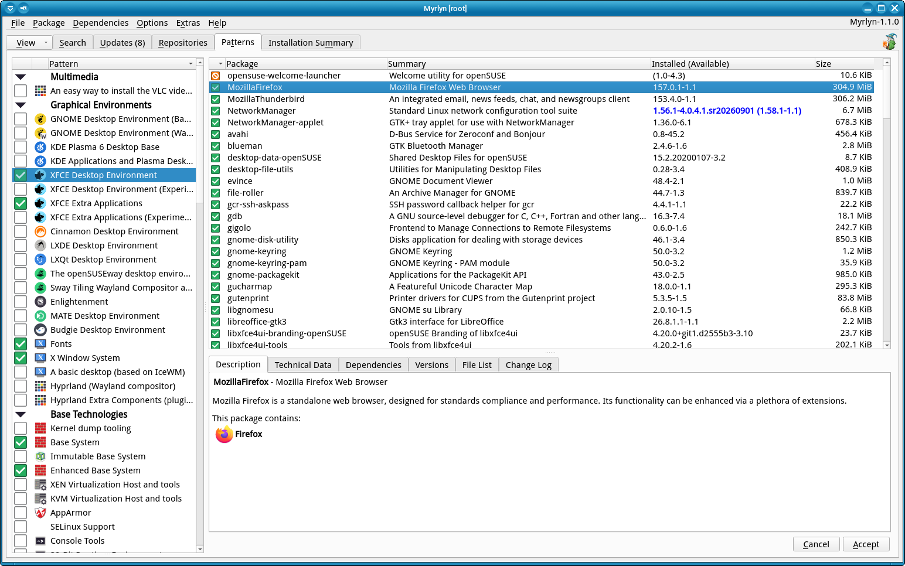

# Myrlyn Help: Patterns

_Author: Stefan Hundhammer (GitHub: @shundhammer)_

_Up: [↗ Help Center](help-center.md)_

 

-------------------------

This is about Myrlyn's "Patterns" view. If you don't see it, use the "View"
button at the left of the open tabs, then "Patterns".

## The Idea Behind Patterns

In the openSUSE / libzypp context, a (software) _pattern_ is a collection of
software packages to give your machine a higher-level capability, such as:

- A graphical desktop environment like KDE Plama / GNOME / Xfce etc.,

- Some kind of server functionality like
  - file server
  - print server
  - web server

- A software development machine for
  - KDE Plasma development (C++, Qt, Kf libs and header files)
  - Java development
  - Python development

To name just a few. A pattern takes care of installing all needed packages for
that task. In many cases, a pattern will also include another pattern; for
example, a C++ development environment is needed for developing KDE Plasma
software, but also for pure Qt software or just for C++ software without any of
those higher-level libraries.

## Invisible Patterns as Building Blocks

When you select a pattern, the package list does not show all those packages,
and not even all the sub-patterns: Some of the lower-level patterns are not
user-visible.

## What is a Pattern Technically?

A pattern is really just a package that does not have any real content that you
would find in the filesystems; it consists mostly of dependencies like
"requires", "recommends" and "suggests", and a "provides" with its pattern
name.

By convention, that pattern pseudo-package has a name that starts with
"patterns-", so you can easily see them all (even the invisible ones) with a
simple package search for packages starting with `patterns-`. Try that and
switch to the "Dependencies" details view below the package list.

## Anatomy of a Pattern Pseudo-Package

(For nerds)

_[↗ Go to topic](pattern-anatomy.md)_

- In Myrlyn
- With zypper
- With an rpm command line

-------------------------

_Next: [↗ Installation Summary](inst-summary.md)_
  &nbsp;&nbsp;&nbsp;&nbsp;&nbsp;&nbsp;
_Previous: [↗ Package Search](search.md)_
