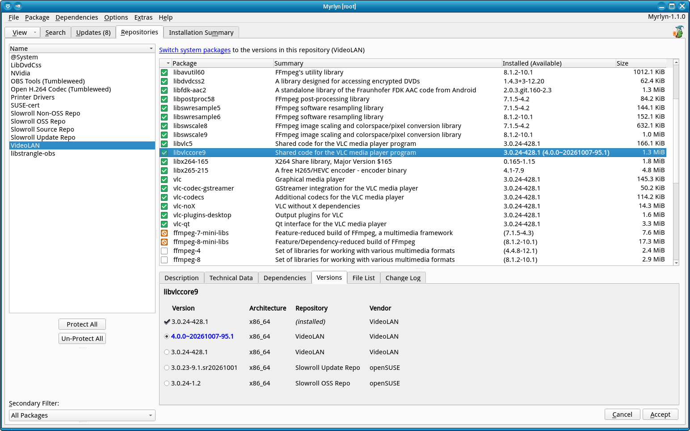

# Myrlyn Help: Repositories View

_Author: Stefan Hundhammer (GitHub: @shundhammer)_

_Up: [↗ Help Center](help-center.md)_

 

-------------------------

This is about Myrlyn's "Repositories" view. If you don't see it, use the "View"
button at the left of the open tabs, then "Repositories".

Note that the repositories _management_ where you can add, edit, and remove
repositories is in a different place: Menu "Extras" -> "Configure
Repositories". See also
[Issue #106: Repository Management](https://github.com/shundhammer/myrlyn/issues/69).

## Filtering by One Repository

The idea behind this view is to let you limit your actions to packages from
just one repo: Select one repo in the repo list on the left, and the package
list is filled with packages that have at least one version from that repo.

This does not mean that the currently installed version of that package comes
from that repo, or the _candidate_ version that would be selected if you were
to mark the package for installation (if it isn't already installed), or for
update (if it is installed). It really only means that this repo offers at
least one version of that package.

This view benefits a lot from switching to the "Versions" details view below
the package list where you can see all versions of the currently selected
package at once in a table.

In the repos list, the topmost entry, "@System", is special: It doesn't
represent a real repo, but the _installed system_, i.e., all the packages that
are currently installed.

## Protect All / Un-Protect All

Some third-party repos, such as Packman or VideoLAN, provide packages that are
also present in the openSUSE OSS or update repos. Those packages may have
slightly different versions, and the repos may have different release cycles
than the openSUSE repos.

This can make updates difficult: You may have to solve dependency problems
manually. One workaround is excluding the affected repos from an update.

This is what the two buttons "Protect All" and "Un-Protect All" do: They set
all installed packages in the package list to status "protected", or back to
"keep installed".

For more details, see _[↗ third party repos and updates](third-party-repos.md)_.

## Secondary Filters

At the bottom of the left panel, you can select one of several _secondary
filters_. They are all limited to packages from the selected repo:

- All packages (the default)

- Installed packages

- Not installed packages

- Search: Package search like the "Search" view,
  but of course limited to packages from this repo.

- Status: Very similar to the "Installation Summary" view:
  Select only packages with a specific status from this repo.

--------------------

## Versions Details View

(See screenshot at the top of this page)

The "Versions" details view below the package list is available in all filter
views, but it is particularly useful in the "Repositories" view: It makes sense
to use related packages from the same repo.

For consistency, use all "vlc" packages either from the VideoLAN repo, or all
from the openSUSE repo. Mixing them is asking for trouble.

### Package Versions

From top to bottom, you see all the different versions of the currently
selected package:

- The installed version, if there is one.
  It also says "(installed)" in the "Repository" column.

- The "candidate" version. This is the "best" version of the package; the one
  that will be picked if you set the package status to "update" (if it is
  already installed) or to "install" (if it is not).

  If the package is installed, and the candidate version is higher than the
  installed version, the version number is displayed in blue. This indicates
  that an update would make sense. However, there is no guarantee that it can
  be updated without dependency problems.

- Any other versions in descending order (from newer to older versions).

  There may be more blue version numbers if several versions are newer than the
  installed one.

For most packages, you can pick _one_ version, as indicated by the round "radio
buttons". If you click on another version, the package status in the package
list changes to "update" if the package is already installed, and to "install"
if it is not.

Note that such an _update_ may also really be a _downgrade_ if you select an
older version than the installed one.

### Architecture

The second column of the "Versions" details view contains the package's
_architecture_:

- _binary_ packages containing binary machine code matching your CPU.
  On most PC hardware, this is "x86_64" or the older "i586".

- "noarch" ("no architecture"): architecture-independent content:
  - Scripting languages (bash, Python, Perl, Ruby etc.)
  - Text (e.g., documentation),
  - Other data that don't depend on the CPU architecture.

### Repository and Vendor

The other columns in the table are "Repository" and "Vendor".

The repository corresponds directly to one of the items in the repo list in the
left panel: It shows from which repo this specific version of the package comes.

The vendor may be a bit more fuzzy: Several repos may have the same vendor
like "openSUSE" because they all come from the same organization.

For example, vendor "openSUSE" is the same for these repos:

- openSUSE "OSS" (Open Source Software): The distribution's main repo.
- openSUSE "Update": Updated packages.
- openSUSE "non-OSS": Software with a license other than Open Source (GPL, BSD, MIT, Apache, ...).

#### Checking Package Vendors for Consistency

If you migrate from openSUSE packages to a third-party repo like Packman,
VideoLAN, or NVidia, or if you update packages for any of those third-party
repos, it is recommended to check whether they all consistently have the same
vendor.

This is one more reason to update the normal system packages with the
third-party packages excluded ("Protect All"), then go back, use "Un-Protect
All", and update them separately.

Before clicking "Accept", switch to the "Versions" view, select the first
package in the package list, and use the "Cursor Down" key to go through the
list one by one and keep a close eye on the vendor of the selected version:
Check if they are all consistently from the same vendor.

### Multiversion Packages

There are some packages like Linux kernels and kernel modules that can be
installed in multiple versions simultaneously. Those package versions have
square _checkboxes_ instead of round _radio buttons_, indicating that you can
select several at the same time.

You can see what multi-version packages are in the distribution by switching to
the "Package Classification" view, then "Multiversion".

-------------------------

_Next: [↗ Best Practices](best-practices.md)_
  &nbsp;&nbsp;&nbsp;&nbsp;&nbsp;&nbsp;
_Previous: [↗ Package Classification View](classification.md)_
