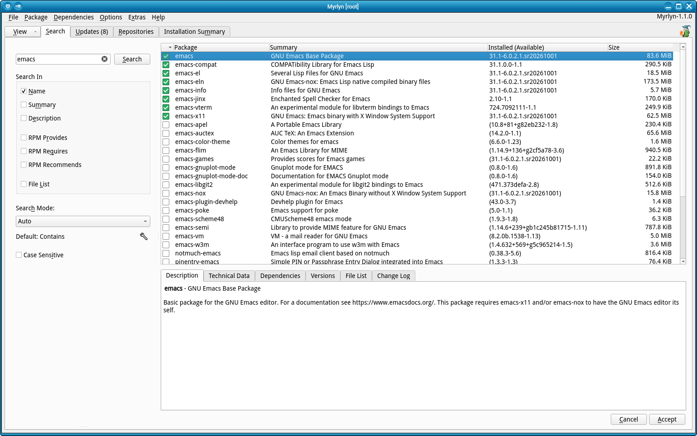

# Myrlyn Help: Package Search

_Author: Stefan Hundhammer (GitHub: @shundhammer)_

_Up: [↗ Help Center](help-center.md)_

 

-------------------------

This is about Myrlyn's "Search" view. If you don't see it, use the "View"
button at the left of the open tabs, then "Search".

The centerpiece of this is the "Search" input field where you enter a _search
term_ to look for.

You can select in what fields of an RPM package you want to search your search term:

- Package name
- Package summary (the short one-liner that you also see in the package list)
- Package description (the multi-line text that you see in the "Description" tab)
- RPM dependencies (see below):
  - Provides
  - Requires
  - Recommends
- File list (the names of the files that belong to the package).

By default, all searches are case-insensitive - unless you check the "Case
sensitive" check below all the other search options.

## Search Modes

- Contains: Find the search term anywhere in the selected fields.
  This is useful for nontrivial search terms, not for very short ones:
  A search term "Qt" would flood you with irrelevant results, especially if you
  search in name, summary, description at the same time.

- Starts with: Find the search term at the beginning of the selected fields.
  This is most useful if searching only in the package name.
  A search term "emacs" returns "emacs", "emacs31", "emacs-client", but not "libemacs".

- Exact match: The field has to match your search term exactly; no more, no less.
  A search term "emacs" returns only "emacs", not "emacs31", "emacs-client",
  "libemacs".

- Wildcards: This allows you to use shell-like wildcards `*` and `?`.

- Regular expression: This allows you to use full-fledged regular expressions
  like in Perl / `grep -E`. Note that this defaults to "contains"; you may
  have to use regexp _anchors_ like `^` (start of the string) and `$` (end of
  the string) if this is not what you want.

- Auto: Guess the mode - see below.

## Auto Search Mode

The default search mode is "Auto" that guesses the mode from your input.

- If a lone `*` or `?` is detected, e.g. `*qt*6*`: Wildcards mode.

- If typical regexp sequences like `.*`, `^`, `$`, `(`, `|`, `[` are detected:
  Regular expression mode.

- If your search term starts with `=`: Exact match.

In "Auto" search mode, you can see in the line below the search mode combo box
what mode is guessed. If no special characters are detected, it uses a default
mode (see below). As you type, it changes as the first of the special
characters listed above is detected.

Of course a guess can also guess wrong. In that (rare) case, you may need to
explicitly change the search mode to the one that you really want.

## Default for Auto Search Mode

If nothing else is detected, "Auto" mode defaults to "Starts with". If you
don't like that, use the little wrench icon to its right to toggle between
"Starts with" and "Contains".

Note that "Contains" mode can _very_ easily also be achieved with a search
term like `*foo*`, end "Ends with" (not in the list) with `*foo`.

## Searching in RPM Provides, Requires, Recommends

Searching in RPM _provides_, _requires_, _recommends_ can be very useful to
find out what other package or pattern causes another package to be installed.

**Important:** Make sure to uncheck the other fields like "Name", "Summary",
"Description" to avoid false positive results.

Check only "Requires" or "Recommends" or both to see what other package depends
on a package like "MozillaFirefox". Switch to the "Dependencies" tab below the
package list and scroll down to "Requires" or "Recommends" to see more details.

"Requires" is a hard requirement; you cannot install a package B that requires
package A without it. "Recommends" is more a suggestion that you can override.

Searching in "Provides" can show "capabilities" of packages, such as "a user
interface for YaST" where more than one exists (YaST-Qt, YaST-NCurses), but
YaST needs at least one of them.

This is how _patterns_ are implemented: They are just packages that only
consist of dependencies, no actual files on the system. They all have a
"Provides: pattern()" that identifies them as a pattern.

Try it: Search for "pattern()", but with an explicit search mode "Starts with"
(to avoid a regexp syntax error). This will list all pattern packages.

Search for "pattern-visible()" to see only the ones that are visible in the
patterns view, not the building blocks such as "patterns-openSUSE-base".

A package always implicitly provides its name, that's why those special
capabilities tend to have weird characters like `()` in their "provides".

## Further Reading

- [Issue #96: Search Modes (with examples)](https://github.com/shundhammer/myrlyn/issues/96)
- [Issue #83: Search Mode Design Philosophy](https://github.com/shundhammer/myrlyn/issues/83)

-------------------------

_Next: [↗ Patterns](patterns.md)_
  &nbsp;&nbsp;&nbsp;&nbsp;&nbsp;&nbsp;
_Previous: [↗ Updates](updates.md)_
