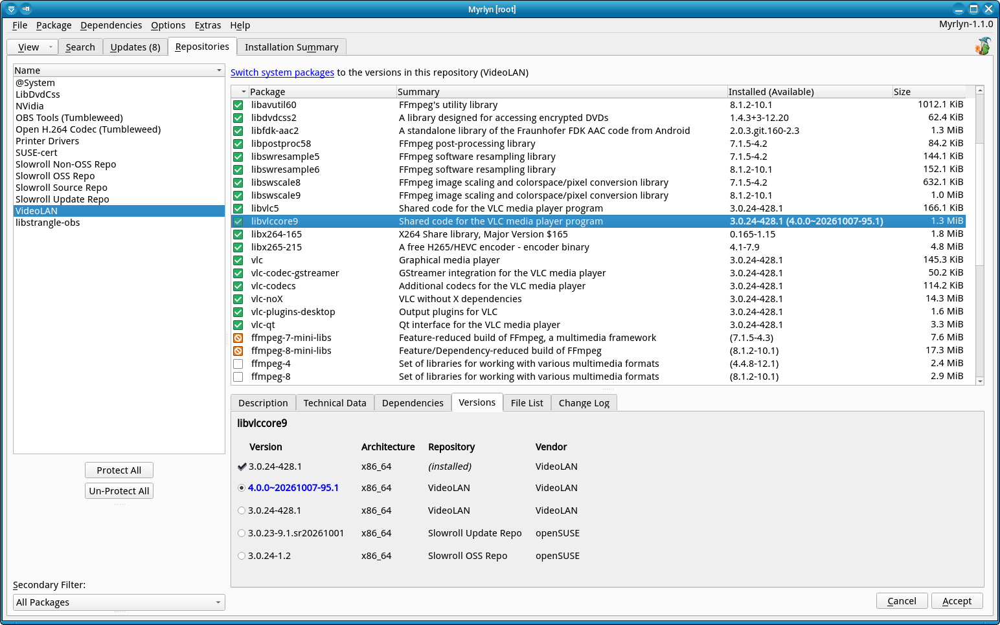

# Myrlyn Help: Third Party Repos and Updates

_Up: [↗ Updates](updates.md)_

 

-------------------------

## Third Party Repos

Some third-party repos like Packman or VideoLAN provide packages that are also
present in the openSUSE OSS or update repos, but with more capabilities or
supporting hardware acceleration for audio, video and similar algorithms.

The reason to use those third-party repos is typically that they provide codecs
or patent-encumbered software that SUSE corporate lawyers don't want SUSE to
ship because of a risk of lawsuits.

## Packages from Third-Party Repos Causing Dependency Problems

Those third-party packages tend to have slightly different versions, and
sometimes they also require library packages in different versions than the
openSUSE repos, and those third-party repos usually have their own update cycle
that doesn't quite match the openSUSE update cycle.

As long as both the third-party repos and the openSUSE repos are in sync,
everthing is fine. But if one or the other lags behind with their versions,
there will be dependency problems.

Very often they are easy enough to resolve, but still annoying: If you get a
dozen dependency problems that all have one "Keep obsolete xy, keep obsolete
yz, ..." solution, simply select that one for each of the problems.

But there is a more convenient approach: Set all packages from that repo to
status "protected" to exclude them from the "dup" / "up".

## Excluding Third-Party Repos From Updates Dup / Up

If a number of packages from a third-party repo have an update candidate
(displayed in the package list as a blue version number), and there are also
updates from the official openSUSE repos, exclude the third-party repo from the
update, then do the update only for the openSUSE packages, then maybe try to
update the third-party packages separately:

- Switch to the "Repositories" view.

- Select the third-party repo to fill the package list with its packages.

- Hit the "Protect All" button:
  It will set all installed packages that are in that repo to "protected",
  i.e. they can't be modfied (no version updates).
  Notice that this doesn't check if the installed version is actually from that
  repo, just that one package version exists from that repo.

- If there are more third-party repos that also have packages that are also in
  the openSUSE repos, and they also have updates, do the same with them.

- Go to the "Updates" view. You will notice that there are now fewer updates in
  the list.

- Hit one of the update buttons.

- (Optional) Go to the "Installation Summary" to check what will be done.
  You may want to uncheck the "protected" status on the left panel to exclude
  the protected packages from the package list.

- Hit the "Accept" button to start the transaction.

- After the transaction, go back, select the "Repositories" view again and
  decide if you now want to update the third-party repos separately.

- If yes, select the third-party repo and hit "Un-Protect All".

- Go to the "Updates" view and do the update for those third-party packages.

- Lots of sad faces? Nevermind; try again some days later.
  The situation will resolve itself eventually.

- Dependency problems? Either select the conservative solution ("keep obsolete
  xy", "don't install xy") or hit "Cancel" in the dependency problem dialog,
  then "Cancel" again in the main window and abandon your changes.

  Notice that this will also undo the "Un-Protect All", so the third-party
  packages remain protected.

-------------------------

_Up: [↗ Updates](updates.md)_
