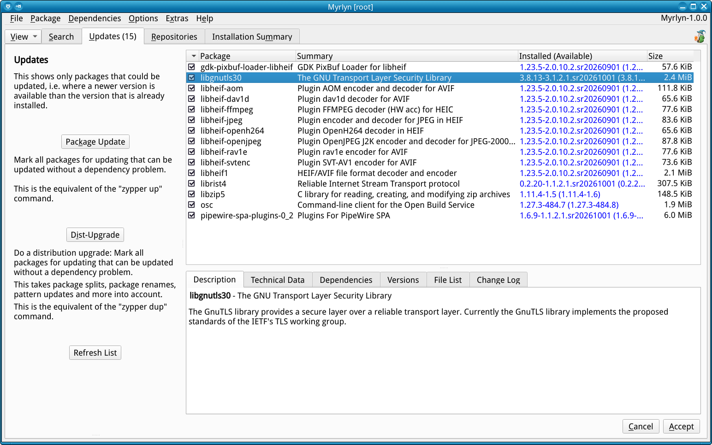

# Myrlyn Help: Updates

_Author: Stefan Hundhammer (GitHub: @shundhammer)_

_Up: [↗ Help Center](help-center.md)_

 

-------------------------

This is about Myrlyn's "Updates" view. If you don't see it, use the "View"
button at the left of the open tabs, then "Updates".

Notice that this view has a number in its tab; in this example "Updates
(8)". This is the number of updates in the list.

## What's in the Package List?

In this view, the package list contains only installed packages that have a
newer version available than the installed one, i.e. an _update candidate_. You
can also this tell from the blue version number.

Notice that this does not guarantee that an update to that version will not
cause dependency problems; this is not yet known yet at this time, only that
there is a newer version available.

## The Difference Between Up and Dup

The updates view offers two update operations:

- "Package Update". This is the same as the `zypper up` command.

- "Dist-Upgrade". This is the same as the `zypper dup` command.

Both operations are done by the libzypp _dependency resolver_, in Myrlyn as in
`zypper`. Both Myrlyn and `zypper` ruun the exact same libzypp code.

### Up

For the "up" command, the dependency resolver goes through the list of packages
that have an update candidate, tries to set the package status to "update"
(just as you would interactively), and resolves the dependencies. If there are
no dependency problems, it keeps the "update" status. If there are any
dependency problems, it restores the status to "keep installed".

### Dup

The "dup" command does the same, but in addition to that, the dependency
resolver also takes package splits, package merges, package renames and changes
in the software _patterns_ into account:

For example, for the first release of Myrlyn the distribution's project mangers
decided that it should be installed by default, so they added a dependency
`Recommends: myrlyn` to the `base-x11_enhanced` pattern. This pattern is in
turn required by graphical desktops.

The net effect is that after a "dup", all systems that had a graphical desktop
automatially got Myrlyn installed as a new package. With only an "up", this
would not have happened.

### Point Releases vs. Rolling Releases

#### Point Releases

Traditional Linux releases like openSUSE Leap are _point releases_: They have
one release day, and after a certain number of months, there is a new release
with a new release number: Leap 15.6 -> Leap 16.0 -> Leap 16.1.

They receive package updates for bug or security fixes, but typically no new
package versions with new features. Those package updates may be bundled in
_patches_ that fix specific bugs or security problems; a patch may contain one
or more packages for that specific bug or security problem. And they will
certainly not receive a completely new package like Myrlyn in the example
above.

On the flip side, no package will be dropped from such a point release; you can
rely on the package being there for the life time of the point release.

#### Rolling Releases

A _rolling release_ like openSUSE Tumbleweed or Slowroll on the other hand is
all about a steady flow of new package versions as they come in from _upstream_
(i.e. from the original authors of that package somewhere on the Internet); not
only bug and security fixes, but also with new features, or entirely new
packages.

And from time to time, a package may also be _dropped_, i.e. removed from the
distribution: If it is abandoned for too long by its upstream authors, if it
doesn't receive any fixes for security problems or other severe bugs, if it
can't be built anymore because it's using libraries or other software that is
completely obsolete and no longer available. This doesn't happen too often, but
it does happen.

With a rolling release, you are always at the _bleeding edge_ of Linux
technology, but you always need to keep up to date, and from time to time, you
may need to fix problems that the constant changes bring with them.

Fortunately, openSUSE Tumbleweed is a very stable rolling release. And
Slowroll, being some weeks delayed compared with Tumbleweed, is even more
stable.

### Update Rules

- For a point release like openSUSE Leap, use "Package Update" ("up").

- For a rolling release like openSUSE Tumbleweed or Slowroll, use
  "Dist-Upgrade" ("dup").

  If this is not possible because of too many dependency problems, it's okay to
  use "up" from time to time. But don't let this become a habit: You will miss
  out on the benefits of a rolling release.

### Patches vs. Updates

As mentioned above, point releases like openSUSE Leap receive _patches_. You
can use the "Patches" view (available only for distributions that actually have
patches) to install them.

But patches are also just RPM pseudo packages (with a nondescript number
instead of a speaking name) consisting only of dependencies like `Requires:
libfoo >= 47.11`; a patch is _satisfied_ if all its dependencies are met.

So if you simply always install all new package versions from the "Updates"
view with "Package Update" ("up"), the patches are also satisfied; the result
is the same.

Technically, it would be wrong to use "Dist-Upgrade" ("dup") for a point
release. But since there will simply never be a brand-new package, no package
dropped, split, renamed, or merged, and no pattern changes, the result will be
the same.

## Checkmarks and Sad Faces

Clicking on one of the "Package Update" or "Dist-Upgrade" buttons does several
things:

- The dependency resolver changes its internal state to one of "up" or "dup"
  (see below).

- It iterates over the packages that have an _update candidate_ version.
  For each one of them:
  - It tries to set its status to "update".
  - It checks if that causes dependency problems:
    - If there are no problems, it keeps the "update" status.
    - If there are dependency problems, it reverts that package's status to "keep installed".

- Myrlyn iterates over the list again.
  For each one of them:
  - If the package status is now "update", it adds a checkmark
    in front of the "version" column in the package list.
  - If the package status is still "keep installed", it adds a sad face emoji
    in front of the "version" column.

**Don't be afraid of the sad faces; it's not an error condition**, it only tells
you "better luck next time".

A package with a sad face does have a newer version, but you still can't update
it to that version; something else in the distribution that it needs might
still be mising. It might need a newer version that is not yet available of a
library package.

If you are curious what prevents the update, try setting it manually to status
"update". You will get a dependency problem report that describes what is
wrong. Of course you need to _undo_ that attempt to update: Select the "do not
install foo-47.11" or "keep obsolete foo-47.11" solution from the list.

## Dependency Resolver State

Both of the two buttons "Package Update" and "Dist-Upgrade" put the dependency
resolver in a special state, "up" or "dup". They both prevent dependency
problems as best as they can; because that's what those "up" and "dup" actions
are all about.

But there is a catch: That dependency resolver state remains active until the
package transaction is executed, i.e. the updated package versions are actually
installed. When you go back from the final "Summary" page, the dependency
resolver is back in its normal state.

This is normally not a problem; unless you decide that just updating isn't
enough, you also want to install some new packages, or you want to remove some
packages. If you do that, and it would create a dependency problem, you might
find yourself "fighting" the dependency resolver: You try to set a package to
another status ("install" or "remove"), and it snaps right back to the previous
state.

The solution is simple: After hitting one of the update buttons, simply execute
the transaction and then maybe go back.

The dependency resolver status is displayed at the bottom of Myrlyn's main
window if it's not the normal mode; if you see "Package Update Mode" or
"Dist-Upgrade Mode" there, don't be surprised that it has some real resistance
to you creating problems.

In a sense, it's just like your Mom when you were little. :smiley:

## Third Party Repos and Updates

_Go to topic: [↗ Third Party Repos and Updates](third-party-repos.md)_

- Packages from third-party repos causing dependency problems
- Excluding third-party repos from dup / up

-------------------------

_Next: [↗ Package Search](search.md)_
  &nbsp;&nbsp;&nbsp;&nbsp;&nbsp;&nbsp;
_Previous: [↗ Customization](customization.md)_
